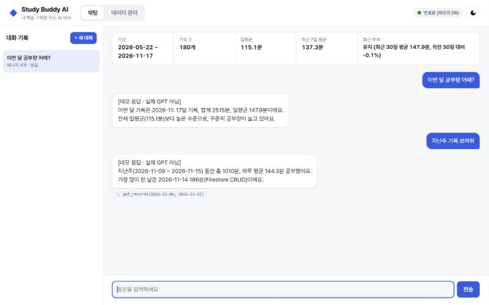
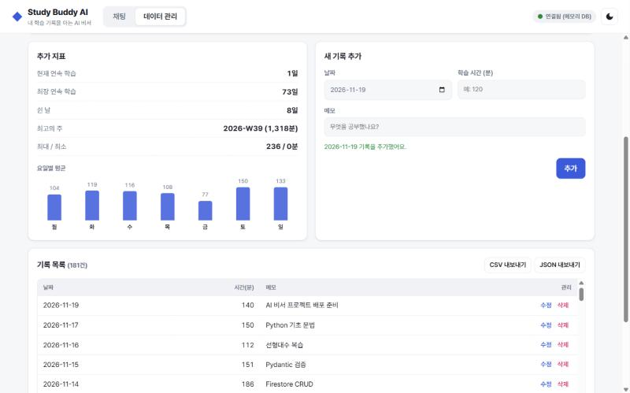
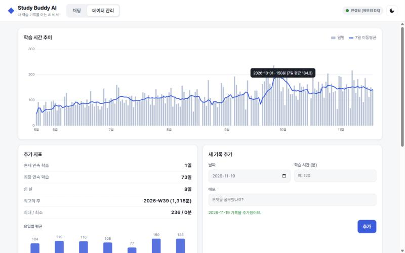
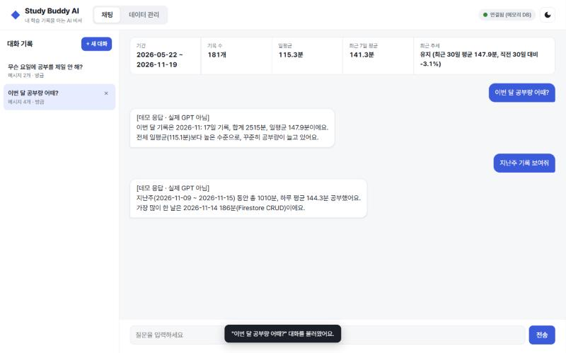
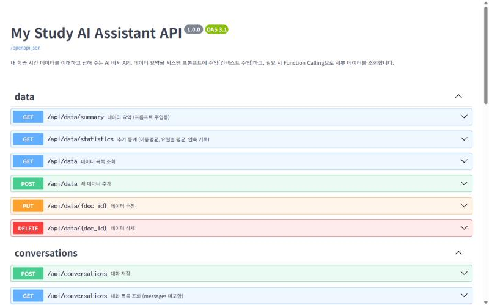

# Study Buddy AI — 내 학습 기록을 아는 AI 비서

> "이번 달 공부 얼마나 했어?"라고 물으면 **내 실제 학습 기록**을 근거로 답해 주는 AI 비서

일반 챗봇은 내 데이터를 모르기 때문에 일반론만 답합니다. Study Buddy AI는 매일의 **학습 시간(분)** 시계열 데이터를
분석해 요약을 만들고, 그 요약을 GPT의 **시스템 프롬프트에 주입**해서 "내 상황을 아는" 답변을 돌려줍니다.
필요하면 GPT가 직접 **도구(Function Calling)** 를 호출해 특정 기간의 원본 기록이나 추가 통계를 조회합니다.

## 배포 URL

| 구분 | URL |
|---|---|
| 프론트엔드 (Vercel) | https://study-buddy-ai-teal.vercel.app |
| 백엔드 API (Render) | https://study-buddy-api-86ag.onrender.com |
| Swagger UI | https://study-buddy-api-86ag.onrender.com/docs |
| 헬스 체크 | https://study-buddy-api-86ag.onrender.com/health |

> 현재 배포 상태: Render 환경 변수에 `OPENAI_API_KEY`, `FIREBASE_SERVICE_ACCOUNT_JSON` 이 아직 없어서
> 백엔드는 **메모리 저장소 + 샘플 180건**으로 동작합니다 (`/health` → `"db": "memory", "ai_ready": false`).
> 데이터 조회/추가/수정/삭제, 요약, 대화 기록은 동작하지만, AI 채팅은 키가 등록되기 전까지 "OPENAI_API_KEY 가 설정되지 않았습니다" 안내를 반환합니다.
> 메모리 저장소이므로 서버가 잠들거나 재배포되면 추가한 데이터는 초기화됩니다. 키 등록 후 자동으로 Firestore 모드로 전환됩니다.

> ⚠️ 백엔드는 Render 무료 티어라 15분간 요청이 없으면 잠듭니다. 첫 접속 시 30초~1분 걸릴 수 있으며,
> 프론트엔드는 `/health` 를 재시도하며 "서버를 깨우는 중" 배너를 보여 줍니다.

## 주요 기능

1. **데이터 기반 AI 채팅** — 요약(기간/개수/평균/추세/월별)을 프롬프트에 주입, 로딩 표시, AI가 호출한 도구 표시
2. **데이터 관리(CRUD)** — `(date, value, memo)` 추가/수정/삭제, 목록 즉시 갱신
3. **대화 기록** — 채팅 시 자동 저장, 목록 조회, 클릭하면 이전 대화 불러와 이어서 대화, 삭제
4. **인사이트 (보너스)** — 일별 막대 + 7일 이동평균 그래프, 요일별 평균, 연속 학습일, 최고의 주, CSV/JSON 내보내기, 다크 모드
5. **Function Calling + MCP Server (보너스)** — 같은 기능을 웹 채팅(GPT 도구)과 MCP 클라이언트 양쪽에서 호출

## 기술 스택

| 영역 | 사용 기술 |
|---|---|
| Backend | Python 3.12, FastAPI, Uvicorn, Pydantic v2 |
| DB | Firebase Firestore (`firebase-admin`) |
| AI | OpenAI Chat Completions API (`gpt-4o-mini`, Function Calling) |
| Frontend | HTML / CSS / Vanilla JavaScript (프레임워크 없음, Canvas 차트 직접 구현) |
| 배포 | Render (백엔드), Vercel (프론트엔드) |
| 보너스 | MCP Python SDK (`mcp`) |

## 데이터

- 주제: **일일 학습 시간(분)** — 2026-05-22 ~ 2026-11-17, **180개 데이터 포인트**
- 생성: [`backend/scripts/generate_data.py`](backend/scripts/generate_data.py) (시드 고정) → [`backend/data/study_log.csv`](backend/data/study_log.csv)
  - 완만한 상승 추세, 요일 패턴(주말↑ 금요일↓), 시험 대비 집중 주간, 가끔 쉬는 날(0분)
- 분석 결과 (`GET /api/data/summary` 예시)

```json
{
  "period": "2026-05-22 ~ 2026-11-17",
  "count": 180,
  "unit": "분",
  "metrics": { "total": 20722, "average": 115.1, "max": 236, "max_date": "2026-09-26",
               "min": 0, "min_date": "2026-05-25", "std": 45.8 },
  "trend": "유지 (최근 30일 평균 147.9분, 직전 30일 대비 -0.1%)",
  "recent_7d_average": 137.3,
  "monthly": [{ "month": "2026-11", "days": 17, "total": 2515, "average": 147.9 }, "..."]
}
```

- 추세 판정: 최근 30일 평균 vs 직전 30일 평균 → ±5% 초과면 상승/하락, 이내면 유지
- 같은 날짜 기록이 여러 개면 합산해 일별 시계열로 만든 뒤 분석

## 프로젝트 구조

```
.
├── backend/                     # FastAPI → Render
│   ├── main.py                  # 앱 생성, CORS, 라우터 등록, 전역 예외 처리, /health
│   ├── app/
│   │   ├── config.py            # 환경 변수 로딩 (키는 코드에 없음)
│   │   ├── schemas.py           # Pydantic 요청/응답 모델 + 검증 규칙
│   │   ├── routers/             # HTTP 계층: 경로, 상태 코드, 의존성 주입만 담당
│   │   │   ├── data.py          #   /api/data (CRUD, summary, statistics)
│   │   │   ├── conversations.py #   /api/conversations
│   │   │   └── chat.py          #   /api/chat (+ IP별 요청 제한)
│   │   ├── services/            # 비즈니스 로직: 분석, 프롬프트 구성, GPT 호출
│   │   │   ├── data_service.py
│   │   │   ├── conversation_service.py
│   │   │   └── chat_service.py
│   │   └── repositories/        # 저장소 계층: Firestore / 메모리 구현을 같은 인터페이스로
│   ├── data/study_log.csv
│   └── scripts/                 # 데이터 생성, Firestore 업로드
├── frontend/                    # Vanilla JS → Vercel
│   ├── index.html, style.css, app.js
│   ├── config.js                # 로컬용 API 주소
│   └── build.js, vercel.json    # 배포 시 API_BASE_URL 환경 변수로 config.js 생성
├── mcp_server/                  # (보너스) MCP Server
└── render.yaml                  # (선택) Render Blueprint
```

**분리 기준**: 라우터는 "HTTP를 어떻게 받고 돌려주는가", 서비스는 "무엇을 계산·판단하는가", 저장소는 "어디에 저장하는가"만 안다.
그래서 `/api/data/summary` 엔드포인트와 `/api/chat` 이 **같은 `build_summary()` 서비스 함수**를 재사용하고,
Firestore 키가 없을 때 메모리 저장소로 바꿔 끼워도 서비스 코드는 그대로다.

## API

| Method | Path | 설명 |
|---|---|---|
| POST | `/api/data` | 새 데이터 추가 |
| GET | `/api/data` | 목록 조회 (`start`, `end`, `order=asc\|desc`, `limit`) |
| PUT | `/api/data/{id}` | 데이터 수정 (부분 수정 가능) |
| DELETE | `/api/data/{id}` | 데이터 삭제 |
| GET | `/api/data/summary` | 데이터 요약 (프롬프트 주입용) |
| GET | `/api/data/statistics` | 추가 지표: 7일 이동평균, 요일별 평균, 연속 학습일, 최고의 주 (보너스) |
| POST | `/api/conversations` | 대화 저장 |
| GET | `/api/conversations` | 대화 목록 — **messages 미포함**, `message_count`/`preview` 만 |
| GET | `/api/conversations/{id}` | 특정 대화 전체 messages 조회 (대화 불러오기, 방식 A) |
| DELETE | `/api/conversations/{id}` | 대화 삭제 |
| POST | `/api/chat` | AI 대화 (`{message, conversation_id?}`) — 요약 주입 + 도구 호출 + 자동 저장 |
| GET | `/health` | 헬스 체크 (DB 종류, AI 키 설정 여부) |

### Firestore 컬렉션

```
data/{autoId}           { date: "2026-11-17", value: 150, memo: "…", created_at, updated_at }
conversations/{autoId}  { title, messages: [{ role: "user"|"assistant", content, created_at }], created_at, updated_at }
```

### 입력 검증 (Pydantic)

| 필드 | 규칙 | 이유 |
|---|---|---|
| `date` | `YYYY-MM-DD`, 2000년 이후, 미래 불가 | 잘못된 날짜가 추세 분석을 오염시키지 않도록 |
| `value` | 0 ≤ value ≤ 1440 | 하루는 1440분 — 음수/비현실적 값 차단 |
| `memo` | 최대 200자, 앞뒤 공백 제거 | 프롬프트/DB 크기 제한 |
| `PUT` 본문 | 최소 1개 필드 필수 | 빈 수정 요청 방지 |
| `message` | 1~1000자, 공백만 불가 | 토큰 비용 보호 |

검증 실패 시 라우터 코드에 도달하기 전에 FastAPI가 **422**와 필드별 오류를 돌려주고, 프론트엔드는 이를 사람이 읽을 수 있는 문장으로 보여 줍니다.
없는 ID는 404, OpenAI 키 미설정은 503, OpenAI 호출 실패는 502, 그 밖의 예외는 상세 정보 없이 500으로 응답합니다.

## 컨텍스트 주입 & Function Calling 흐름

```
사용자 질문 ─▶ POST /api/chat
                 │
                 ├─ 1. build_summary()          ← GET /api/data/summary 와 같은 함수
                 ├─ 2. 요약을 시스템 프롬프트에 삽입 (오늘 날짜 포함)
                 ├─ 3. 이전 대화 최근 10개 + 질문을 붙여 GPT 호출 (tools 4개 제공)
                 │        │
                 │        ├─ 요약만으로 답할 수 있음 ──────────────▶ 답변
                 │        └─ 세부 데이터 필요 → tool_call 반환
                 │              └─ 서버가 도구 실행 → 결과를 tool 메시지로 전달 → 재호출 (최대 3회)
                 └─ 4. 질문+답변을 conversations 에 자동 저장 → {reply, conversation_id, summary, tool_calls}
```

시스템 프롬프트 (실제 템플릿: [`chat_service.py`](backend/app/services/chat_service.py))

```
당신은 사용자의 '일일 학습 시간' 기록을 분석해 주는 친절한 데이터 분석 비서입니다.
오늘 날짜: 2026-11-18

[사용자 데이터 요약]
- 데이터 기간: 2026-05-22 ~ 2026-11-17
- 총 레코드: 180개
- 주요 지표: 합계 20722분, 일평균 115.1분, 최대 236분(2026-09-26), 최소 0분(2026-05-25), 표준편차 45.8
- 최근 7일 평균: 137.3분
- 최근 트렌드: 유지 (최근 30일 평균 147.9분, 직전 30일 대비 -0.1%)
- 월별 요약: 2026-11: 17일 기록, 합계 2515분, 일평균 147.9분 …
```

### 도구와 호출 근거

| 도구 | GPT가 호출하는 경우 (description에 명시) | 예시 질문 |
|---|---|---|
| `get_records(start_date, end_date, limit)` | 요약에 없는 **특정 날짜/기간의 원본 기록**이 필요할 때 | "지난주 기록 보여줘", "어제 뭐 공부했지?" |
| `get_statistics()` | **패턴·습관** 질문 (요일별, 연속 기록) | "무슨 요일에 공부를 제일 안 해?" |
| `get_data_summary()` | 대화 도중 데이터가 바뀌어 **최신 요약**이 필요할 때 | "방금 추가한 거 반영해서 다시 알려줘" |
| `list_conversations(limit)` | **예전 대화**에 대한 질문 | "예전에 내가 뭐 물어봤지?" |

"이번 달 공부량 어때?"처럼 요약(월별 합계/평균)만으로 답할 수 있으면 도구 없이 바로 답하고,
"지난주 기록 보여줘"처럼 일별 값이 필요하면 `get_records` 를 호출합니다.
웹 화면에서는 AI 답변 아래에 `🔧 get_records(2026-11-09, 2026-11-15)` 처럼 호출된 도구가 표시됩니다.

### MCP Server (외부 채널)

[`mcp_server/server.py`](mcp_server/server.py)는 같은 4개 도구를 MCP로 노출합니다. 배포된 REST API를 호출하는 얇은 어댑터라
웹 채팅과 MCP 클라이언트(예: Claude Desktop)가 **같은 Firestore 데이터**를 봅니다.

```
Claude Desktop ──(MCP stdio)──▶ mcp_server/server.py ──(HTTPS)──▶ Render FastAPI ──▶ Firestore
웹 브라우저   ──(HTTPS)────────────────────────────────────────▶ Render FastAPI ──▶ Firestore
```

```powershell
cd mcp_server; python -m venv .venv; .venv\Scripts\pip install -r requirements.txt
```

Claude Desktop `claude_desktop_config.json`:

```json
{
  "mcpServers": {
    "study-buddy": {
      "command": "C:/<path>/mcp_server/.venv/Scripts/python.exe",
      "args": ["C:/<path>/mcp_server/server.py"],
      "env": { "STUDY_API_BASE_URL": "https://<your-api>.onrender.com" }
    }
  }
}
```

## 로컬 실행

### 1) 백엔드

```powershell
cd backend
python -m venv .venv
.venv\Scripts\activate
pip install -r requirements.txt
copy .env.example .env      # 값 채우기
uvicorn main:app --reload   # http://localhost:8000/docs
```

- Firebase 키 없이도 실행 가능: `FIREBASE_SERVICE_ACCOUNT_JSON` 이 비어 있으면 **메모리 저장소 + 샘플 180건**으로 뜹니다 (재시작 시 초기화, `/health` 의 `db` 값이 `memory`).
- Firestore에 샘플 데이터 업로드 (최초 1회):

```powershell
python -m scripts.seed_firestore
```

### 2) 프론트엔드

```powershell
cd frontend
python -m http.server 5500   # http://localhost:5500
```

`frontend/config.js` 의 `API_BASE_URL` 기본값은 `http://localhost:8000` 입니다.

## 환경 변수

### 백엔드 (Render / `backend/.env`)

| 이름 | 필수 | 설명 |
|---|---|---|
| `OPENAI_API_KEY` | ✅ | OpenAI API 키 |
| `FIREBASE_SERVICE_ACCOUNT_JSON` | ✅ | 서비스 계정 키 **JSON 문자열 전체** (Render) 또는 **키 파일 경로** (로컬) |
| `ALLOWED_ORIGINS` | ✅ | CORS 허용 도메인, 쉼표 구분 (예: `https://<your-app>.vercel.app,http://localhost:5500`) |
| `DB_BACKEND` | | `auto`(기본) / `firestore` / `memory` — 배포에서는 `firestore` 로 두면 키 누락 시 조용히 메모리로 빠지지 않고 바로 실패 |
| `SEED_SAMPLE_IF_EMPTY` | | 기본 `true` — Firestore `data` 컬렉션이 비어 있으면 서버 시작 시 샘플 180건을 한 번 업로드 |
| `OPENAI_MODEL` | | 기본 `gpt-4o-mini` |
| `OPENAI_MAX_TOKENS` | | 답변 최대 토큰, 기본 600 |
| `CHAT_RATE_LIMIT_PER_MIN` | | IP당 분당 채팅 요청 수, 기본 10 |
| `CHAT_HISTORY_LIMIT` | | GPT에 함께 보낼 이전 메시지 수, 기본 10 |

### 프론트엔드 (Vercel)

| 이름 | 필수 | 설명 |
|---|---|---|
| `API_BASE_URL` | ✅ | 백엔드 주소 (예: `https://<your-api>.onrender.com`). 빌드 시 `build.js` 가 `config.js` 로 생성 |

## 배포

### 백엔드 — Render

1. GitHub에 푸시 (`.env`, 키 파일은 `.gitignore` 로 제외됨)
2. Render → New → **Web Service** → 저장소 선택
   - Root Directory: `backend`
   - Build Command: `pip install -r requirements.txt`
   - Start Command: `uvicorn main:app --host 0.0.0.0 --port $PORT`
3. Environment에 위 백엔드 환경 변수 등록 (`FIREBASE_SERVICE_ACCOUNT_JSON` 은 키 파일 내용을 통째로 붙여넣기)
4. 배포 후 `https://<your-api>.onrender.com/docs` 확인

(또는 루트의 `render.yaml` 로 Blueprint 생성)

### 프론트엔드 — Vercel

1. Vercel → Add New Project → 같은 저장소 선택
2. Root Directory: `frontend` (Build/Output 설정은 `vercel.json` 이 지정: `node build.js` → `dist`)
3. Environment Variables: `API_BASE_URL=https://<your-api>.onrender.com`
4. 배포된 Vercel 도메인을 Render의 `ALLOWED_ORIGINS` 에 추가 → Render 재배포

## 보안 · 운영 메모

- **키 관리**: 모든 키는 환경 변수로만 주입. 프론트엔드에는 OpenAI/Firebase 키가 전혀 없고 백엔드 주소만 있음
- **CORS**: 브라우저는 다른 도메인(Vercel → Render) 요청을 기본 차단 → `ALLOWED_ORIGINS` 에 등록된 도메인만 허용 (`*` 사용 안 함)
- **비용 보호**: `max_completion_tokens` 제한, 도구 호출 최대 3회, 이전 대화 10개만 전송, IP당 분당 요청 제한
- **오류 노출 최소화**: 처리되지 않은 예외는 로그로만 남기고 클라이언트에는 일반 메시지
- **XSS 방지**: 프론트엔드는 사용자/AI 텍스트를 `innerHTML` 이 아닌 `textContent` 로만 렌더링

## 스크린샷

> ⚠️ **데모 모드 캡처**: 아래 화면은 로컬에서 OpenAI/Firebase 키 없이 촬영했습니다.
> 백엔드·프론트엔드·데이터·요약·도구 호출 흐름은 실제 코드 그대로이고, DB는 메모리 저장소(샘플 180건)입니다.
> 단, **AI 답변은 GPT가 아니라** 같은 요약/도구 결과로 숫자를 채운 스크립트 응답이며, 답변 첫 줄에 `[데모 응답 · 실제 GPT 아님]` 으로 표시했습니다.
> 실제 키로 배포한 뒤 다시 캡처해 교체할 예정입니다.

### 1. 데이터 요약이 보이는 채팅 화면 (질문 + 답변)

상단에 요약(기간/기록 수/일평균/최근 7일 평균/추세)이 보이고, 두 번째 답변 아래에 AI가 호출한 도구 `get_records(2026-11-09, 2026-11-15)` 가 표시됩니다.



### 2. 데이터 관리 화면 (추가 동작)

2026-11-19 기록(140분)을 추가 → "기록을 추가했어요" 메시지, 목록 181건으로 갱신, 맨 위에 새 행 표시.



추세 그래프(일별 + 7일 이동평균, 마우스 오버 툴팁)와 추가 지표(연속 학습일, 최고의 주, 요일별 평균):



### 3. 대화 기록 화면 (불러오기)

새 대화를 시작한 뒤 왼쪽 목록에서 이전 대화 "이번 달 공부량 어때?"를 클릭 → 메시지 4개가 다시 표시되고 "대화를 불러왔어요" 안내가 뜹니다.



### 4. Swagger UI (로컬 `/docs`)


